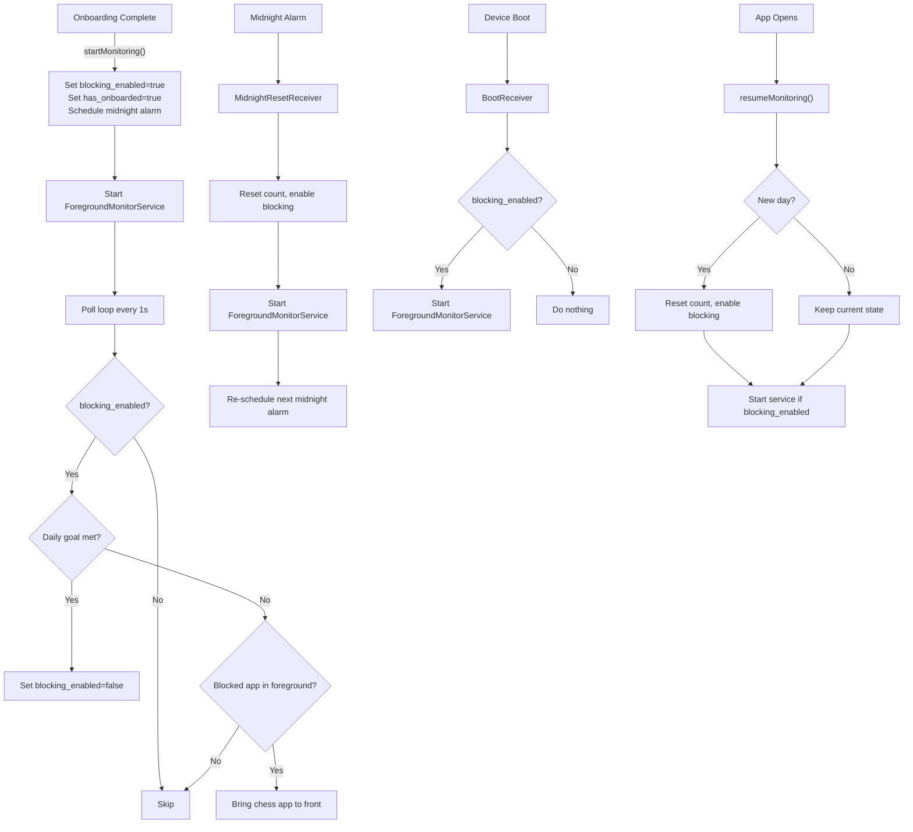

# Fix Blocking Restart After Reboot & Midnight

## Blocking Workflow Report

### Current Architecture

The app blocks distracting apps by running a **ForegroundMonitorService** that polls `UsageStatsManager` every 1 second. When a blocked app moves to foreground, it brings the chess puzzles app to front instead.

### Key Components

| Component | File | Role |
|---|---|---|
| **PermissionModule** | [PermissionModule.kt](file:///d:/NoScrollScreenTimeChessPuzzles/MyApp/android/app/src/main/java/com/jskarthik/noscrollscreentimechesspuzzles/PermissionModule.kt) | React Native bridge — `startMonitoring`, `resumeMonitoring`, `enableBlocking`, `disableBlocking`, `scheduleMidnightReset` |
| **ForegroundMonitorService** | [ForegroundMonitorService.kt](file:///d:/NoScrollScreenTimeChessPuzzles/MyApp/android/app/src/main/java/com/jskarthik/noscrollscreentimechesspuzzles/ForegroundMonitorService.kt) | Foreground service that polls usage events and blocks apps |
| **BootReceiver** | [BootReceiver.kt](file:///d:/NoScrollScreenTimeChessPuzzles/MyApp/android/app/src/main/java/com/jskarthik/noscrollscreentimechesspuzzles/BootReceiver.kt) | Restarts service after device reboot |
| **MidnightResetReceiver** | [MidnightResetReceiver.kt](file:///d:/NoScrollScreenTimeChessPuzzles/MyApp/android/app/src/main/java/com/jskarthik/noscrollscreentimechesspuzzles/MidnightResetReceiver.kt) | Fires at midnight to reset daily count & re-enable blocking |
| **App.js** | [App.js](file:///d:/NoScrollScreenTimeChessPuzzles/MyApp/App.js) | On app open, calls `resumeMonitoring()` and `scheduleMidnightReset()` |
| **AndroidManifest.xml** | [AndroidManifest.xml](file:///d:/NoScrollScreenTimeChessPuzzles/MyApp/android/app/src/main/AndroidManifest.xml) | Declares receivers and service |

### SharedPreferences Keys (ChessBlockerPrefs)

| Key | Type | Purpose |
|---|---|---|
| `blocking_enabled` | Boolean | Whether blocking is currently active |
| `has_onboarded` | Boolean | Whether user completed onboarding |
| `blocked_apps` | String (JSON) | Map of app keys → enabled booleans |
| `problem_target` | Int | Daily puzzle goal |
| `today_date` | String | Current date for puzzle counting |
| `today_count` | Int | Puzzles solved today |

---

## Root Cause Analysis

### Bug 1: Blocking doesn't restart after reboot

> [!CAUTION]
> **The BootReceiver only checks `blocking_enabled` — but when the user completes their daily goal, `blocking_enabled` is set to `false`.** After reboot (which happens overnight or at any time), the old `blocking_enabled=false` value persists, so the BootReceiver does nothing.

**Root cause**: BootReceiver doesn't perform a new-day check. If blocking was disabled yesterday because the goal was met, and the phone reboots today, `blocking_enabled` is still `false` → service never starts.

Additionally:
- BootReceiver does **not** re-schedule the midnight alarm after boot, so even if blocking restarts, the next midnight alarm is lost.
- BootReceiver does **not** add the `LOCKED_BOOT_COMPLETED` action, which is needed for `directBootAware` devices (Android 7+).

### Bug 2: Blocking doesn't restart after midnight

> [!WARNING]
> **The midnight alarm uses `setExactAndAllowWhileIdle`, but on Android 12+ (API 31+), `SCHEDULE_EXACT_ALARM` is a runtime permission that the user must grant.** Without it, `setExactAndAllowWhileIdle` silently fails — no alarm is set, no midnight reset occurs.

Additional issues:
- The manifest declares `SCHEDULE_EXACT_ALARM` but the app never actually **checks** whether the permission is granted (on API 31+ it's not granted by default for non-alarm apps).
- If the alarm does fire but the service was killed by the OS, there is no fallback mechanism.
- The `ForegroundMonitorService` itself could also perform date-change detection during its poll loop as a safety net, but currently doesn't.

---

## Proposed Changes

### 1. BootReceiver — Add new-day detection & alarm rescheduling

#### [MODIFY] [BootReceiver.kt](file:///d:/NoScrollScreenTimeChessPuzzles/MyApp/android/app/src/main/java/com/jskarthik/noscrollscreentimechesspuzzles/BootReceiver.kt)

- After boot, perform the same new-day check as `resumeMonitoring()`: if `today_date` differs from today, reset `today_count=0`, `blocking_enabled=true`, update `today_date`.
- Always re-schedule the midnight alarm after boot (it was lost during reboot).
- Always start the ForegroundMonitorService if `has_onboarded=true` (the service itself checks `blocking_enabled` internally and will gracefully skip if disabled).

---

### 2. MidnightResetReceiver — Switch from exact alarms to inexact + add self-healing

#### [MODIFY] [MidnightResetReceiver.kt](file:///d:/NoScrollScreenTimeChessPuzzles/MyApp/android/app/src/main/java/com/jskarthik/noscrollscreentimechesspuzzles/MidnightResetReceiver.kt)

- Before scheduling an exact alarm, check `AlarmManager.canScheduleExactAlarms()` on API 31+. If not allowed, fall back to `setAndAllowWhileIdle` (inexact but guaranteed to work).
- Add `today_date` update in the reset to ensure the new date is stored.

---

### 3. ForegroundMonitorService — Add built-in new-day detection (safety net)

#### [MODIFY] [ForegroundMonitorService.kt](file:///d:/NoScrollScreenTimeChessPuzzles/MyApp/android/app/src/main/java/com/jskarthik/noscrollscreentimechesspuzzles/ForegroundMonitorService.kt)

- During each `pollUsageEvents()` call, if the service is running but blocking is disabled, check if it's a new day. If so, re-enable blocking automatically. This is a **safety net** for when the midnight alarm doesn't fire.
- This makes the service self-healing — even if the alarm fails, blocking will restart within 1 second of opening a blocked app the next day.

---

### 4. AndroidManifest — Add direct boot awareness

#### [MODIFY] [AndroidManifest.xml](file:///d:/NoScrollScreenTimeChessPuzzles/MyApp/android/app/src/main/AndroidManifest.xml)

- Add `android:directBootAware="true"` to BootReceiver.
- Add `LOCKED_BOOT_COMPLETED` intent filter so the receiver triggers even before the user unlocks the device.

---

## Open Questions

> [!IMPORTANT]
> **Android 12+ exact alarm permission**: On API 31+, `SCHEDULE_EXACT_ALARM` requires a user opt-in. Your app already has the `SCHEDULE_EXACT_ALARM` permission in the manifest, but there is no UI to prompt the user. The plan above handles this by **falling back to inexact alarms** when permission is denied. The inexact alarm may fire a few minutes after midnight rather than exactly at midnight, but combined with the ForegroundMonitorService safety net, blocking will reliably restart. Is this acceptable, or do you want to add a settings prompt for exact alarm permission?

---

## Verification Plan

### Manual Verification
1. **Reboot test**: Enable blocking, complete daily goal (so `blocking_enabled=false`), reboot the device. Verify blocking restarts.
2. **Midnight test**: Enable blocking, complete daily goal, wait past midnight (or manually set device time). Verify blocking restarts the next day.
3. **Kill-and-reopen test**: Force stop the app, then reopen it. Verify `resumeMonitoring()` picks up the new day and re-enables blocking.

### Build Verification
- Build the APK with `./gradlew assembleRelease` to verify no compilation errors.
